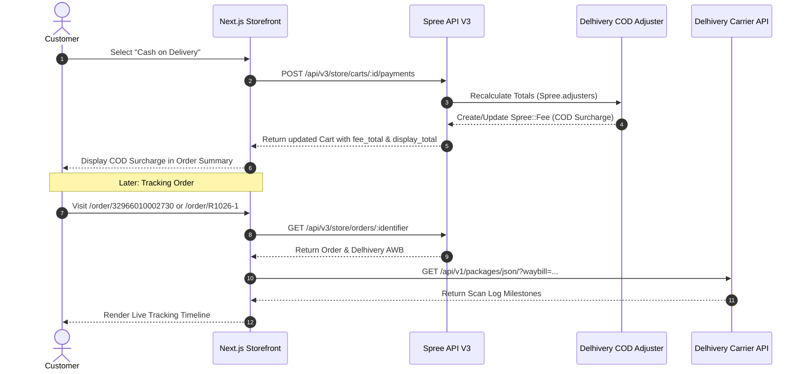

# Storefront Integration Guide (Next.js App Router)

> [!NOTE]
> **Optional Frontend Integration Guide**
> The `spree_delhivery` Ruby gem is a backend Rails engine that provides delivery rate calculation, fulfillment providers, and COD adjusters for Spree 6 API V3. The Next.js components, tracking timeline, and order search views documented below are reference implementations for storefront developers building with the Spree Next.js Storefront (`apps/storefront`).

This comprehensive guide details how to integrate **Spree Delhivery** with the Spree 6 Next.js Storefront (`apps/storefront`).

It covers two core experiences:
1. **Dynamic Cash on Delivery (COD) Surcharge** in checkout.
2. **Production Order Tracking & Live Delhivery API Integration** with customer search and milestone timeline.

---

## Architecture Overview



---

## Part 1: Cash on Delivery (COD) Dynamic Surcharge

Spree 6 uses typed line items (`Spree::Fee`) rather than legacy adjustments. The plugin registers `Spree::Adjusters::DelhiveryCodFee` in `Spree.adjusters`. To reflect fee changes instantly in the frontend without full-page reloads, follow these steps:

### 1. Display Surcharge in Checkout Summary

**File:** `apps/storefront/src/components/checkout/Summary.tsx`

Locate the `tax` total row in the totals section and insert the `fee_total` block:

```tsx
{parseFloat(cart.tax_total ?? "0") > 0 && (
  <div className="flex justify-between text-sm">
    <span className="text-gray-700">{tc("tax")}</span>
    <span className="text-gray-900">{cart.display_tax_total}</span>
  </div>
)}

{/* Dynamic COD Surcharge Row */}
{parseFloat(cart.fee_total ?? "0") > 0 && (
  <div className="flex justify-between text-sm">
    <span className="text-gray-700">COD Surcharge</span>
    <span className="text-gray-900">{cart.display_fee_total}</span>
  </div>
)}
```

---

### 2. Display Surcharge on Order Confirmation & Details

**File:** `apps/storefront/src/components/order/OrderTotals.tsx`

```tsx
{Number.parseFloat(order.tax_total ?? "0") > 0 && (
  <div className="flex justify-between text-sm">
    <span className="text-gray-500">{t("tax")}</span>
    <span className="text-gray-900">{order.display_tax_total}</span>
  </div>
)}

{/* Dynamic COD Surcharge Row */}
{Number.parseFloat(order.fee_total ?? "0") > 0 && (
  <div className="flex justify-between text-sm">
    <span className="text-gray-500">COD Surcharge</span>
    <span className="text-gray-900">{order.display_fee_total}</span>
  </div>
)}
```

---

### 3. Server Actions Return Updated Cart

**File:** `apps/storefront/src/lib/data/payment.ts`

Ensure `createDirectPayment` and `createCheckoutPaymentSession` fetch and return the freshly calculated `cart`:

```typescript
export async function createCheckoutPaymentSession(
  cartId: string,
  paymentMethodId: string,
  externalData?: Record<string, unknown>,
) {
  return actionResult(async () => {
    const surface = await resolveSurfaceForCart(cartId);
    const options = await getCartOptions(surface);
    const id = await requireCartId(surface);
    const session = await getClientForSurface(
      surface,
    ).carts.paymentSessions.create(
      id,
      {
        payment_method_id: paymentMethodId,
        ...(externalData && { external_data: externalData }),
      },
      options,
    );
    updateTag(checkoutTag(surface));
    const cart = await getCart(id, surface);
    return { session, cart };
  }, "Failed to create payment session");
}

export async function createDirectPayment(
  cartId: string,
  paymentMethodId: string,
) {
  return actionResult(async () => {
    const surface = await resolveSurfaceForCart(cartId);
    const options = await getCartOptions(surface);
    const id = await requireCartId(surface);
    const payment = await getClientForSurface(surface).carts.payments.create(
      id,
      { payment_method_id: paymentMethodId },
      options,
    );
    updateTag(checkoutTag(surface));
    const cart = await getCart(id, surface);
    return { payment, cart };
  }, "Failed to create payment");
}
```

---

### 4. Real-Time Surcharge Update in PaymentSection

**File:** `apps/storefront/src/components/checkout/PaymentSection.tsx`

Add `onCartChange?: (cart: Cart) => void` to `PaymentSectionProps`, and invoke `onCartChange(result.cart)` whenever payment methods are switched:

```tsx
interface PaymentSectionProps {
  // ...
  onCartChange?: (cart: Cart) => void;
}

// Switching to COD:
createDirectPayment(cart.id, newMethod.id)
  .then((result) => {
    if (result.success && result.cart) {
      onCartChange?.(result.cart);
    }
  })
  .finally(() => {
    setLoading(false);
    router.refresh();
  });

// Switching to Prepaid (Razorpay / Stripe):
if (result.success && result.session) {
  if (result.cart) {
    onCartChange?.(result.cart);
  }
  router.refresh();
}
```

---

### 5. Wire `onCartChange` in CheckoutPageContent

**File:** `apps/storefront/src/app/[country]/[locale]/(checkout)/checkout/[id]/CheckoutPageContent.tsx`

```tsx
<PaymentSection
  ref={paymentRef}
  cart={cart}
  countries={countries}
  isAuthenticated={isAuthenticated}
  fetchStates={fetchStates}
  onUpdateBillingAddress={handleUpdateBillingAddress}
  onPaymentComplete={handlePaymentComplete}
  onCartChange={setCart}
  processing={processing}
  setProcessing={setProcessing}
  onSessionMethodChange={setIsSessionPayment}
  errors={sectionErrors.payment}
/>
```

---

## Part 2: Backend Lookup Decorator

To allow customers to look up tracking details by **Order Number** (`R1026-1`), **Delhivery Waybill / AWB** (`32966010002730`), **Customer Email**, or **Phone Number**:

**File:** `server/app/controllers/spree/api/v3/store/orders_controller_decorator.rb`

```ruby
# frozen_string_literal: true

module Spree
  module Api
    module V3
      module Store
        module OrdersControllerDecorator
          def find_order!
            raw_id = CGI.unescape(CGI.unescape(params[:id].to_s.strip)).sub(/^#/, '').strip.gsub('%40', '@')
            cart_pk = Spree::Cart.decode_own_prefixed_id(raw_id) rescue nil

            @order = if cart_pk
                       scope.find_by!(cart_id: cart_pk)
                     elsif raw_id.start_with?('or_')
                       scope.find_by_prefix_id!(raw_id)
                     else
                       # 1. Look up by case-insensitive order number
                       found = scope.where('upper(spree_orders.number) = ?', raw_id.upcase).first

                       # 2. Look up by delivery tracking number / waybill
                       found ||= scope.joins(fulfillments: :deliveries).where(
                         'spree_deliveries.tracking_number ILIKE ? OR spree_deliveries.tracking_url ILIKE ?',
                         "%#{raw_id}%", "%#{raw_id}%"
                       ).first

                       # 3. Look up by fulfillment tracking string
                       found ||= scope.joins(:fulfillments).where(
                         'spree_fulfillments.tracking ILIKE ?', "%#{raw_id}%"
                       ).first

                       # 4. Look up by customer email
                       if raw_id.include?('@')
                         found ||= scope.where('lower(spree_orders.email) = ?', raw_id.downcase).order(completed_at: :desc, id: :desc).first
                         found ||= scope.where('spree_orders.email ILIKE ?', "%#{raw_id}%").order(completed_at: :desc, id: :desc).first
                       end

                       # 5. Look up by phone number (matches national/international formats)
                       digits = raw_id.gsub(/\D/, '')
                       if digits.length >= 7
                         last10 = digits.length >= 10 ? digits[-10..] : digits
                         found ||= scope.joins('LEFT JOIN spree_addresses ON spree_addresses.id = spree_orders.ship_address_id OR spree_addresses.id = spree_orders.bill_address_id')
                                        .where('REGEXP_REPLACE(spree_addresses.phone, \'[^0-9]\', \'\', \'g\') LIKE ?', "%#{last10}%")
                                        .order(completed_at: :desc, id: :desc).first
                       end

                       found || scope.find_by!(number: raw_id)
                     end
          end

          def scope
            base_scope = current_store.orders.complete
            if order_token.present? || current_user.present?
              storefront_access_policy.scope(base_scope, token: order_token)
            else
              base_scope
            end.includes(:market, :fulfillments)
          end
        end
      end
    end
  end
end

Spree::Api::V3::Store::OrdersController.prepend(Spree::Api::V3::Store::OrdersControllerDecorator)
```

---

## Part 3: Live Delhivery Tracking Client

**File:** `apps/storefront/src/lib/data/tracking.ts`

```typescript
export interface DelhiveryScanEvent {
  scan: string;
  instructions: string;
  dateTime: string;
  location: string;
  statusCode?: string;
}

export interface DelhiveryTrackingInfo {
  waybill: string;
  status: string;
  statusType?: string;
  statusCode?: string;
  statusDateTime: string | null;
  statusLocation: string | null;
  statusInstructions: string | null;
  origin: string | null;
  destination: string | null;
  expectedDeliveryDate: string | null;
  pickupDateTime: string | null;
  senderName: string | null;
  scans: DelhiveryScanEvent[];
}

export function extractWaybill(trackingOrUrl?: string | null): string | null {
  if (!trackingOrUrl) return null;
  const str = trackingOrUrl.trim();
  const match = str.match(/(?:package\/|waybill=|\b)(\d{10,16})\b/);
  return match ? match[1] : str.replace(/\D/g, "").slice(0, 16) || null;
}

export async function getDelhiveryTracking(
  waybillOrUrl?: string | null,
): Promise<DelhiveryTrackingInfo | null> {
  const waybill = extractWaybill(waybillOrUrl);
  if (!waybill) return null;

  const token = process.env.DELHIVERY_API_TOKEN;
  if (!token) {
    console.warn("[Delhivery] DELHIVERY_API_TOKEN is not set in storefront environment.");
    return null;
  }

  try {
    const url = `https://track.delhivery.com/api/v1/packages/json/?waybill=${encodeURIComponent(waybill)}`;
    const response = await fetch(url, {
      method: "GET",
      headers: {
        Authorization: `Token ${token}`,
        Accept: "application/json",
      },
      next: { revalidate: 60 },
    });

    if (!response.ok) return null;

    const data = await response.json();
    const shipmentData = data?.ShipmentData?.[0]?.Shipment;
    if (!shipmentData) return null;

    const scans: DelhiveryScanEvent[] = Array.isArray(shipmentData.Scans)
      ? shipmentData.Scans.map((s: any) => {
          const detail = s.ScanDetail || s;
          return {
            scan: detail.Scan || detail.scan || "Status Update",
            instructions: detail.Instructions || detail.instructions || "",
            dateTime: detail.ScanDateTime || detail.StatusDateTime || "",
            location:
              detail.ScannedLocation ||
              detail.Location ||
              detail.StatusLocation ||
              "",
            statusCode: detail.StatusCode || detail.statusCode || "",
          };
        })
      : [];

    return {
      waybill: shipmentData.AWB || waybill,
      status: shipmentData.Status?.Status || "In Transit",
      statusType: shipmentData.Status?.StatusType || "",
      statusCode: shipmentData.Status?.StatusCode || "",
      statusDateTime: shipmentData.Status?.StatusDateTime || null,
      statusLocation: shipmentData.Status?.StatusLocation || null,
      statusInstructions: shipmentData.Status?.Instructions || null,
      origin: shipmentData.Origin || null,
      destination: shipmentData.Destination || null,
      expectedDeliveryDate: shipmentData.ExpectedDeliveryDate || null,
      pickupDateTime: shipmentData.PickUpDateTime || null,
      senderName: shipmentData.SenderName || null,
      scans,
    };
  } catch (error) {
    console.error(`[Delhivery Tracking] Error:`, error);
    return null;
  }
}
```

---

## Part 4: Storefront Tracking Routes & Components

### 1. Order Details & Tracking SSR Page
**File:** `apps/storefront/src/app/[country]/[locale]/(storefront)/order/[number]/page.tsx`

```typescript
import type { Metadata } from "next";
import { connection } from "next/server";
import { OrderNotFoundView } from "@/components/order/OrderNotFoundView";
import { OrderTrackingView } from "@/components/order/OrderTrackingView";
import { getOrder } from "@/lib/data/orders";
import { extractWaybill, getDelhiveryTracking } from "@/lib/data/tracking";

interface OrderTrackingPageProps {
  params: Promise<{
    country: string;
    locale: string;
    number: string;
  }>;
}

export async function generateMetadata({
  params,
}: OrderTrackingPageProps): Promise<Metadata> {
  const { number } = await params;
  return {
    title: `Order #${number} - Tracking & Details`,
    description: `Track shipment and view order summary for #${number}`,
  };
}

export default async function OrderTrackingPage({
  params,
}: OrderTrackingPageProps) {
  await connection();
  const { country, locale, number } = await params;
  const basePath = `/${country}/${locale}`;
  const decodedQuery = decodeURIComponent(number || "").trim();

  const order = await getOrder(decodedQuery);
  if (!order) {
    return <OrderNotFoundView number={decodedQuery} basePath={basePath} />;
  }

  const fulfillment = order.fulfillments?.[0];
  const rawTracking =
    fulfillment?.tracking ||
    (fulfillment as any)?.tracking_number ||
    (fulfillment as any)?.deliveries?.[0]?.tracking_number ||
    (fulfillment as any)?.deliveries?.[0]?.tracking_url ||
    fulfillment?.tracking_url ||
    null;

  const waybill = extractWaybill(rawTracking);
  let liveTracking = null;
  if (waybill) {
    liveTracking = await getDelhiveryTracking(waybill);
  }

  return (
    <OrderTrackingView
      order={order}
      liveTracking={liveTracking}
      basePath={basePath}
      locale={locale}
    />
  );
}
```

### 2. Search Lookup Route
**File:** `apps/storefront/src/app/[country]/[locale]/(storefront)/order/page.tsx`

```typescript
import type { Metadata } from "next";
import { OrderLookupView } from "@/components/order/OrderLookupView";

interface OrderSearchPageProps {
  params: Promise<{
    country: string;
    locale: string;
  }>;
}

export const metadata: Metadata = {
  title: "Track Your Order - Live Carrier Tracking",
  description: "Track your shipment, view carrier milestone updates, and check delivery status.",
};

export default async function OrderSearchPage({
  params,
}: OrderSearchPageProps) {
  const { country, locale } = await params;
  const basePath = `/${country}/${locale}`;

  return <OrderLookupView basePath={basePath} />;
}
```

